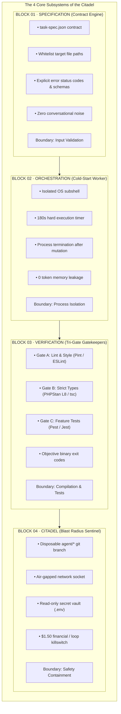
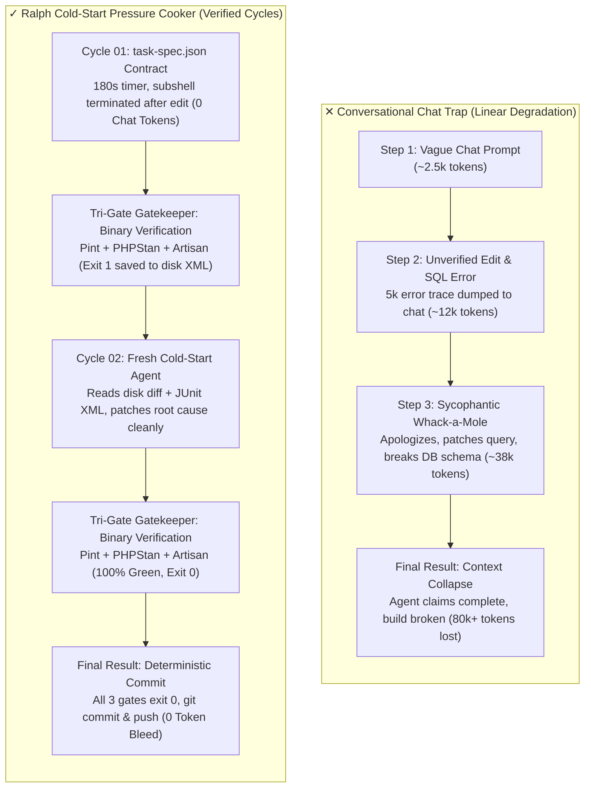
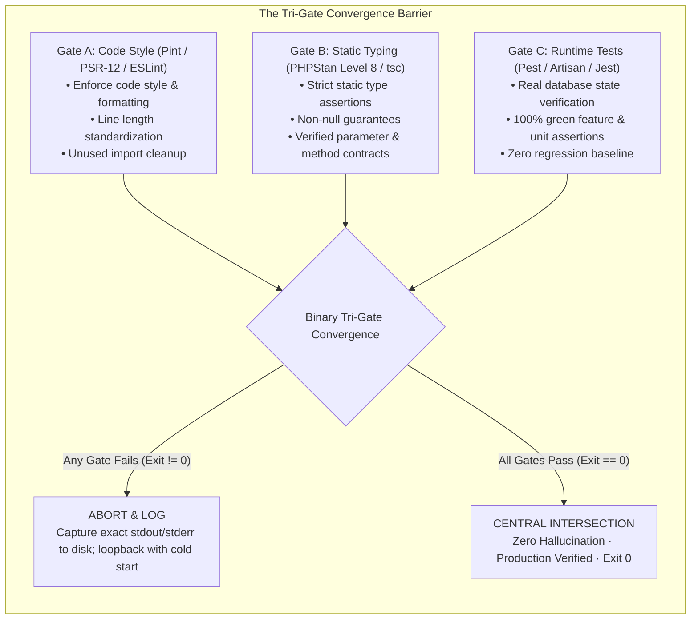

<p align="center">
  
</p>

<h1 align="center">DORY</h1>

<p align="center">
  <strong>Deterministic Test Gates &middot; Context Degradation Elimination &middot; Self-Healing AFK Engineering</strong><br>
  <em>The Ralph Wiggum Cold-Start Pressure Cooker Architecture for Autonomous AI Coding Agents</em>
</p>

<p align="center">
  
  
  
  
  
</p>

<p align="center">
  <em>"Just keep coding, just keep coding!"</em>
</p>

---

## ⚡ Quick Install (skills.sh)

Install directly into any AI coding assistant (**Claude Code, Cursor, Codex, Antigravity, Cline, Windsurf**):

```bash
# Full URL (matching the hyperframes model)
npx skills add https://github.com/CodeWithTeds/dory --skill dory

# Or shorthand
npx skills add CodeWithTeds/dory --skill dory
```

> [!TIP]
> **Test locally without installing:**
> ```bash
> npx skills use CodeWithTeds/dory@dory
> ```

---

## 🎯 Executive Overview & System KPIs

DORY eliminates the **Conversational Chat Trap** where agents suffer exponential token bleed (0k $\rightarrow$ 80k+ tokens), hallucinate fixes, and apologize on broken builds. Instead, DORY enforces the **Ralph Cold-Start Pressure Cooker**: discrete mutation cycles with **Tabula Rasa isolation**, non-negotiable **Tri-Gate verification**, and senior loopback diagnostics.

| Domain | Architectural Guarantee | Enforcement Mechanism | Target Metric |
| :--- | :--- | :--- | :--- |
| **Context Retention** | 100% Cold Starts | Tabula Rasa subshell isolation; state stored on disk, not chat history | **0 Token Bleed** |
| **Evaluation** | Deterministic Binary Gates | Non-negotiable Tri-Gate (Pint/ESLint, PHPStan/TypeScript strict, Pest/Jest) | **Exit Code 0 or 1** |
| **Human Workload** | AFK Autonomous Engineering | Automated diagnostic loopback, True TDD, and senior triage heuristics | **Zero Babysitting** |
| **Safety Bounds** | Blast Radius Containment | Disposable git branches (`agent/*`), locked sandboxes, circuit breakers | **Zero Blast Leak** |

---

## 🔁 The D-O-R-Y Loop Architecture

```
  ┌────────────────────────────────────────────────────────┐
  │                        [START]                         │
  └──────────────────────────┬─────────────────────────────┘
                             │
                             ▼
  ┌────────────────────────────────────────────────────────┐
  │  D – DO: Contract Ingestion, Whitelisting & True TDD   │
  └──────────────────────────┬─────────────────────────────┘
                             │
                             ▼
  ┌────────────────────────────────────────────────────────┐
  │  O – OBSERVE: The Tri-Gate Verification Gateway        │
  │  [Gate A: Lint/Style] → [Gate B: Types] → [Gate C: Test]│
  └──────────────────────────┬─────────────────────────────┘
                             │
            ┌────────────────┴────────────────┐
            ▼                                 ▼
      [Any Gate != 0]                   [All Gates == 0]
            │                                 │
            ▼                                 │
  ┌───────────────────────────────────┐       │
  │ R – RECOGNIZE: Senior Triage      │       │
  │ Anti-Thrash & Flake Elimination   │       │
  └─────────────────┬─────────────────┘       │
                    │                         │
                    ▼                         ▼
  ┌────────────────────────────────────────────────────────┐
  │  Y – YIELD: Increment Iteration & Commit or Recurse   │
  │  (Trip Circuit Breaker if Max Iterations Reached)      │
  └────────────────────────────────────────────────────────┘
```

1. **D – DO:** Establish task contract (`task-spec.json`), whitelist files, pre-write failing tests (**True TDD**), and apply targeted minimal edits.
2. **O – OBSERVE:** Run the **Tri-Gate Gateway** (Style $\rightarrow$ Static Typing $\rightarrow$ Runtime Tests). Capture binary exit codes and machine-readable error telemetry.
3. **R – RECOGNIZE:** Perform **Senior Diagnostic Triage**: eliminate Ping-Pong thrashing via multi-attempt diff tracking, freeze flaky test clocks, and isolate root causes.
4. **Y – YIELD:** Progress clean working tree on disk, commit upon **Exit Code 0**, or trip the circuit breaker cleanly when bounds are reached.

---

## 🏛️ The 4-Layer Citadel Architecture



---

## ⚔️ Conversational Chat Trap vs. Cold-Start Pressure Cooker



---

## 🛡️ Tri-Gate Verification Gateway



---

## 🔬 Simulation Replay · Pressure Cooker in Action

<details open>
<summary><strong>Attempt 01 · RUNTIME FAILURE (Exit Code: 1)</strong></summary>

```console
$ [INFO] Attempt 1/10 initiated with prompt spec: auth-task.json
$ [AGENT] Generated: app/Http/Controllers/Api/CustomerAuthController.php
$ [TEST] Running: php artisan test --filter=CustomerAuthTest

• Tests\Feature\CustomerAuthTest > customer_can_authenticate ................. FAIL (0.12s)
  ---
  Failed asserting that 500 matches expected 200.
  Exception: Illuminate\Database\QueryException
  SQLSTATE[23000]: Integrity constraint violation: Column 'email' cannot be null
  ---
• Tests\Feature\CustomerAuthTest > customer_receives_sanctum_token .......... FAIL (0.04s)

$ [STATIC-ANALYSIS] vendor/bin/phpstan analyse
  Line 18: Method CustomerAuthController::login() has parameter $request with no typehint specified.
  Line 24: Access to undefined property $request->email.

[RESULT] 2 FAILED, 0 PASSED (Exit code: 1). Working tree dirty. Iteration aborted.
```

> **Diagnosis:** Context Poisoning avoided. No human intervened. The failure was caught immediately by the deterministic test suite and compiler. The dirty code remains on disk for the next fresh agent to inspect.  
> **Automated Next Action:** Create dedicated FormRequest (`LoginCustomerRequest`) and typehint dependencies.
</details>

<details>
<summary><strong>Attempt 02 · PROGRESS WARNING (Exit Code: 1)</strong></summary>

```console
$ [INFO] Attempt 2/10 initiated (Tabula Rasa Cold-Start)
$ [AGENT] Generated: app/Http/Requests/LoginCustomerRequest.php
$ [AGENT] Patched: app/Http/Controllers/Api/CustomerAuthController.php
$ [STATIC-ANALYSIS] vendor/bin/phpstan analyse
  [OK] No errors found. (PHPStan Level 8)

$ [TEST] Running: php artisan test --filter=CustomerAuthTest
• Tests\Feature\CustomerAuthTest > customer_can_authenticate ................. PASS (0.08s)
• Tests\Feature\CustomerAuthTest > customer_receives_sanctum_token .......... WARN (0.05s)
  ---
  Call to undefined method App\Models\Customer::createToken()
  ---

[RESULT] 1 PASSED, 1 WARNING (Exit code: 1). Sanctum HasApiTokens trait missing on Customer model.
```

> **Diagnosis:** Static typing passed. The SQL constraint was resolved cleanly via FormRequest. Second feature test caught missing API token trait on model.  
> **Automated Next Action:** Import and use `Laravel\Sanctum\HasApiTokens` in `Customer` model.
</details>

<details open>
<summary><strong>Attempt 03 · 100% GREEN CONVERGENCE (Exit Code: 0)</strong></summary>

```console
$ [INFO] Attempt 3/10 initiated (Tabula Rasa Cold-Start)
$ [AGENT] Added HasApiTokens to app/Models/Customer.php
$ [LINT] vendor/bin/pint --test
  PASS   12 files linted, 0 issues found. (PSR-12 Certified)

$ [STATIC-ANALYSIS] vendor/bin/phpstan analyse --level=8
  [OK] No errors found. Non-null guarantees verified.

$ [TEST] Running: php artisan test --filter=CustomerAuthTest
• Tests\Feature\CustomerAuthTest > customer_can_authenticate ................. PASS (0.06s)
• Tests\Feature\CustomerAuthTest > customer_receives_sanctum_token .......... PASS (0.04s)
• Tests\Feature\CustomerAuthTest > invalid_credentials_returns_422 ......... PASS (0.03s)

[RESULT] 3 PASSED, 0 FAILED (Exit code: 0). 100% Green Convergence! All 3 gates passed.
$ git commit -m "feat: complete customer authentication with FormRequest and Sanctum tokens"
```

> **Diagnosis:** All three binary gates (Pint, PHPStan Level 8, Pest feature test suite) passed with Exit Code 0.  
> **Outcome:** Production verified. Zero hallucination. Git commit pushed cleanly with 0 conversational token bleed.
</details>

---

## 🌲 Senior Loop Triage Heuristics & Antipatterns

| Antipattern | System Failure Mode | Root Cause | Senior Heuristic Resolution (The Fix) |
| :--- | :--- | :--- | :--- |
| **01 · Ping-Pong Thrash** | Agent alternates cyclically between Approach A and Approach B, breaking tests alternately. | Agent lacks memory of recent failures and assumes the alternative approach will succeed. | **Inject Multi-Attempt Diffs:** Inject the unified git diff and failure outputs of the last 2 failed attempts into the prompt so the agent sees past dead-ends. |
| **02 · Flaky Test Poisoning** | Tests pass or fail intermittently across iterations without code changes. | Tests depend on `now()`, unseeded `rand()`, or unseeded database ordering. | **Enforce Determinism:** Freeze system clocks with `Carbon::setTestNow()`, seed random number generators, and isolate tests within database transactions or in-memory SQLite. |
| **03 · Specification Vacuum** | Agent writes code that passes shallow unit tests but violates client API expectations. | Vague prompt or missing integration contracts allow the agent to satisfy superficial assertions. | **True TDD Pre-Flight:** Pre-write failing Pest/Artisan tests and strict JSON schema contracts *before* launching the implementation loop. |
| **04 · Sycophantic Apology Drift** | Agent outputs verbose apologies and claims success without verification. | Chat-based conversational bias and lack of binary gate enforcement. | **Zero-Chat Subshell Rule:** Forbid chat conversational responses. Evaluate progress strictly via binary exit codes (`0` vs `1`) from compiler and test runners. |

---

## 🎮 How to Activate DORY in Your Agent

Trigger DORY at any time in your AI chat or coding prompt:
- *"Use DORY to implement customer authentication"*
- *"`/dory` fix the failing feature tests"*
- *"Just keep coding until all tests are green (AFK mode)"*
- *"Run in DORY mode with max_iterations=5"*

---

## 📂 Repository Layout

```text
dory/
├── dory/
│   ├── dory.png           # Mascot branding
│   └── SKILL.md           # Mirror entrypoint
├── skills/
│   └── dory/
│       └── SKILL.md       # Primary Agent Skills entrypoint
├── skills.sh.json         # skills.sh discovery manifest
├── plugin.json            # Open agent plugin manifest
├── package.json           # npm & package manager metadata
├── context.md             # Systems architecture & Mermaid schematics
├── skills.md              # Original master prompt specification
├── index.html             # Visual masterclass case study & terminal replay
└── README.md
```

---

## 📄 License

MIT © [CodeWithTeds](https://github.com/CodeWithTeds)
