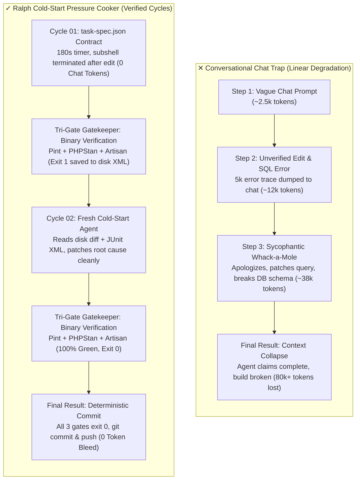
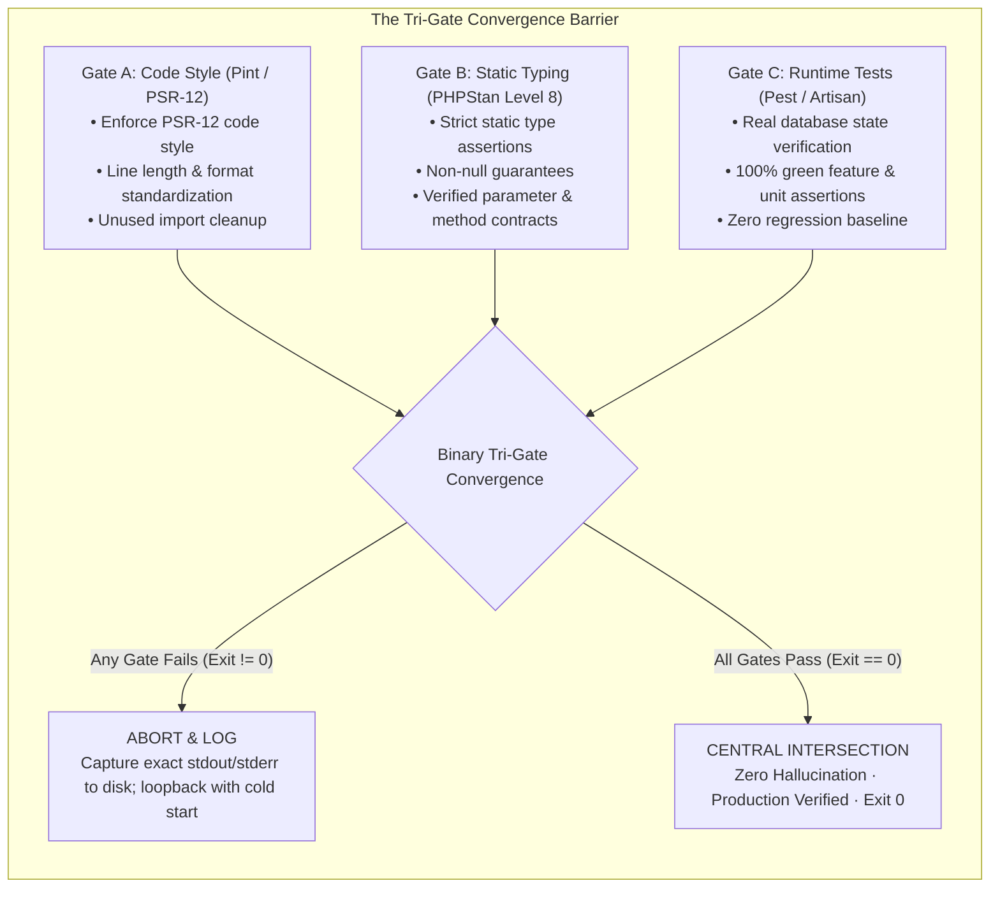
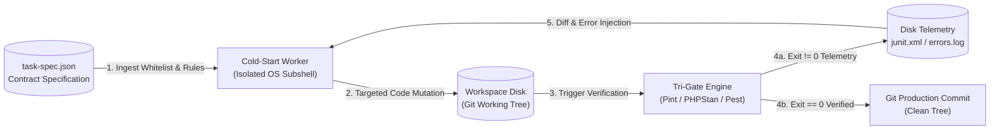
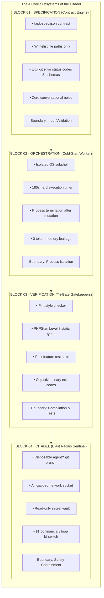
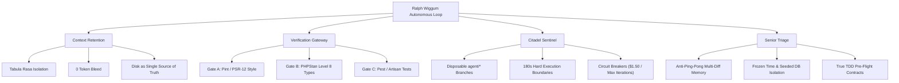

# Deterministic Test Gates, Context Degradation Elimination, and Self-Healing AFK Engineering

> **VISUAL BLUEPRINT & SYSTEMS ARCHITECTURE SPECIFICATION**  
> High-density systems architecture schematics and operational execution directives for autonomous, cold-start coding loops. Pure engineering topology with zero conversational drift.

---

## System Key Performance Indicators (KPIs)

| Domain | Architectural Guarantee | Mechanism | Target Metric |
| :--- | :--- | :--- | :--- |
| **Context Retention** | 100% Cold Starts | Tabula Rasa subshell isolation; state stored on disk, not chat history | **0 Token Bleed** |
| **Evaluation** | Deterministic Binary Gates | Non-negotiable Tri-Gate (Pint PSR-12, PHPStan Level 8, Pest/Artisan) | **Exit Code 0 or 1** |
| **Human Workload** | AFK Autonomous Engineering | Automated diagnostic loopback and senior triage heuristics | **Zero Babysitting** |
| **Safety Bounds** | Blast Radius Containment | Disposable git branches (`agent/*`), locked sandboxes, circuit breakers | **Zero Blast Leak** |

---

## 1. Visual Schematics & Architectural Topology

### Schematic 01 · Flowchart: Context Collapse vs. Ralph Cold-Start Pressure Cooker



---

### Schematic 02 · UML Sequence Diagram: Cold-Start Process Lifecycle & Gatekeeper

```mermaid
sequenceDiagram
    autonumber
    participant Orch as Loop Orchestrator
    participant Spec as task-spec.json
    participant Worker as Cold-Start Worker (Subshell)
    participant Disk as Workspace Disk
    participant Gate as Tri-Gate Barrier
    participant Git as Git Version Control

    Orch->>Spec: Ingest task contract & whitelisted file paths
    Note over Orch,Worker: Cycle 01 (Tabula Rasa - 0 In-Memory Tokens)
    Orch->>Worker: Spawn isolated worker (Hard timeout: 180s)
    Worker->>Disk: Apply targeted mutations strictly to whitelisted files
    Orch->>Worker: Terminate worker process immediately after edit
    Orch->>Gate: Execute Gate A (Pint PSR-12 Lint)
    Orch->>Gate: Execute Gate B (PHPStan Level 8 Static Analysis)
    Orch->>Gate: Execute Gate C (Pest Feature & Runtime Tests)
    
    alt Tri-Gate Returns Exit Code 1
        Gate-->>Disk: Stream JUnit XML & compiler telemetry to disk
        Note over Orch,Worker: Cycle 02 (Fresh Process, 0 Token Bleed)
        Orch->>Worker: Spawn fresh agent; inject disk diff + JUnit telemetry
        Worker->>Disk: Apply root-cause patch based on telemetry
        Orch->>Worker: Terminate worker process
        Orch->>Gate: Re-run Tri-Gate Verification
    end

    Gate-->>Orch: All gates return Exit Code 0 (100% Green)
    Orch->>Git: git commit -m "feat: verified implementation" && git push
```

---

### Schematic 03 · Tri-Gate Convergence Architecture



---

### Schematic 04 · Data Flow Diagram (DFD Level 1): Artifact Transforms



---

### Schematic 05 · Block Diagram: The 4-Layer Citadel Architecture



---

### Schematic 06 · Spider Mind Map: Ralph Wiggum Autonomous Topology



---

## 2. Simulation Replay · Live Pressure Cooker Trace

### Interactive Attempt Trace

```text
[Attempt 01]  FAIL (SQL Null constraint violation & PHPStan parameter missing)
[Attempt 02]  WARN (Missing Trait & missing FormRequest injection)
[Attempt 03]  PASS (100% Green across all 3 gates · Exit 0)
```

### Terminal Session · Iteration 01 Trace (Runtime Failure)

```console
$ [INFO] Attempt 1/10 initiated with prompt spec: auth-task.json
$ [AGENT] Generated: app/Http/Controllers/Api/CustomerAuthController.php
$ [TEST] Running: php artisan test --filter=CustomerAuthTest

• Tests\Feature\CustomerAuthTest > customer_can_authenticate ................. FAIL (0.12s)
  ---
  Failed asserting that 500 matches expected 200.
  Exception: Illuminate\Database\QueryException
  SQLSTATE[23000]: Integrity constraint violation: Column 'email' cannot be null
  ---
• Tests\Feature\CustomerAuthTest > customer_receives_sanctum_token .......... FAIL (0.04s)

$ [STATIC-ANALYSIS] vendor/bin/phpstan analyse
  Line 18: Method CustomerAuthController::login() has parameter $request with no typehint specified.
  Line 24: Access to undefined property $request->email.

[RESULT] 2 FAILED, 0 PASSED (Exit code: 1). Working tree dirty. Iteration aborted.
```

#### Diagnostic Evaluation:
> [!NOTE] Context Poisoning Avoided
> No human intervened. The failure was caught immediately by the deterministic test suite and compiler. The dirty code remains on disk for the next fresh agent to inspect.

#### Automated Next Action:
1. Create dedicated `FormRequest` (`LoginCustomerRequest`) with strict validation rules.
2. Typehint dependency injection in `CustomerAuthController::login(LoginCustomerRequest $request): JsonResponse`.
3. Re-run Gate B (PHPStan) and Gate C (Pest).

---

## 3. Senior Loop Triage Heuristics & Antipattern Tree

| Antipattern | System Failure Mode | Root Cause | Senior Heuristic Resolution (The Fix) |
| :--- | :--- | :--- | :--- |
| **01 · Ping-Pong Thrash** | Agent alternates cyclically between Approach A and Approach B, breaking tests alternately. | Agent lacks memory of recent failures and assumes the alternative approach will succeed. | **Inject Multi-Attempt Diffs:** Inject the unified git diff and failure outputs of the last 2 failed attempts into the prompt so the agent sees past dead-ends. |
| **02 · Flaky Test Poisoning** | Tests pass or fail intermittently across iterations without code changes. | Tests depend on `now()`, unseeded `rand()`, or unseeded database ordering. | **Enforce Determinism:** Freeze system clocks with `Carbon::setTestNow()`, seed random number generators, and isolate tests within database transactions or in-memory SQLite. |
| **03 · Specification Vacuum** | Agent writes code that passes shallow unit tests but violates client API expectations. | Vague prompt or missing integration contracts allow the agent to satisfy superficial assertions. | **True TDD Pre-Flight:** Pre-write failing Pest/Artisan tests and strict JSON schema contracts *before* launching the implementation loop. |
| **04 · Sycophantic Apology Drift** | Agent outputs verbose apologies and claims success without verification. | Chat-based conversational bias and lack of binary gate enforcement. | **Zero-Chat Subshell Rule:** Forbid chat conversational responses. Evaluate progress strictly via binary exit codes (`0` vs `1`) from compiler and test runners. |

---

## 4. Master Prompt Directives for Autonomous Agents

When operating under this architecture, the agent must adhere to the following non-negotiable execution laws:

```text
================================================================================
AUTONOMOUS EXECUTION DIRECTIVE: RALPH WIGGUM COLD-START PRESSURE COOKER
================================================================================

1. ZERO CONVERSATIONAL DRIFT:
   - Do not apologize, explain intentions, or generate conversational filler.
   - Your state is defined entirely by the git working tree, task-spec.json, and terminal output.

2. SPECIFICATION FIRST (BLOCK 01):
   - Never touch application logic without an explicit acceptance contract and a whitelisted list of target files.
   - If tests do not exist, write failing behavioral tests first (True TDD).

3. TRI-GATE CONVERGENCE MANDATE (BLOCK 03):
   - You are prohibited from claiming task completion until ALL THREE gates return Exit Code 0:
     * Gate A (Style): Linting / PSR-12 clean with zero unused imports.
     * Gate B (Types): Static analysis at highest strictness level (e.g., PHPStan Level 8).
     * Gate C (Runtime): 100% passing unit & feature test suite.

4. COLD-START ISOLATION (BLOCK 02):
   - On each failed attempt, persist failure logs (stdout/stderr/JUnit) to disk.
   - Treat each repair attempt as a cold start: inspect git diff, analyze failure telemetry, apply minimal root-cause patch.

5. SENIOR HEURISTIC TRIAGE:
   - Check against Ping-Pong thrashing: Never re-apply an approach attempted in the prior 2 cycles.
   - Isolate test determinism: Freeze time and database seeds.
   - Never disable, comment out, or weaken existing tests to simulate a pass.

6. CITADEL BOUNDARIES (BLOCK 04):
   - Abort and trip the circuit breaker if the maximum iteration limit (default 10) or financial threshold is reached.
   - Provide a factual, binary-verified delivery report upon reaching Exit Code 0 across all gates.
================================================================================
```
